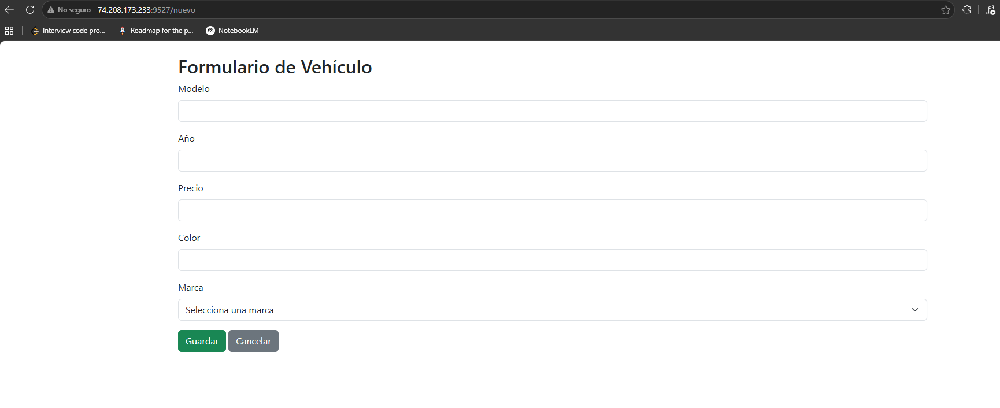
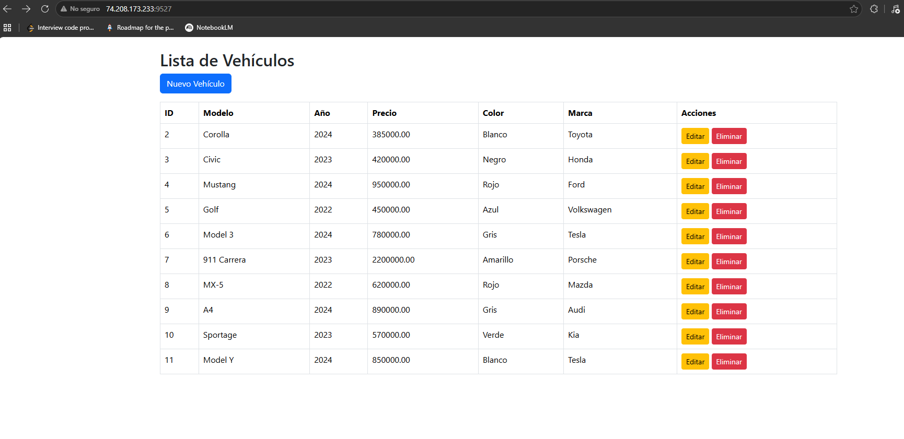
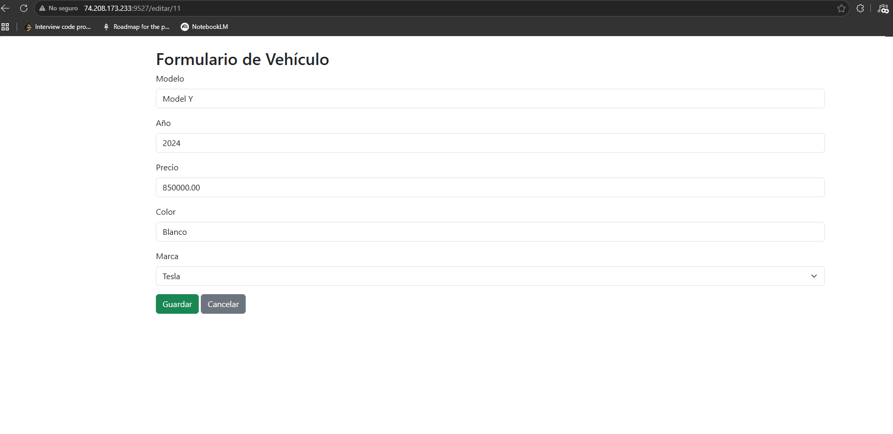
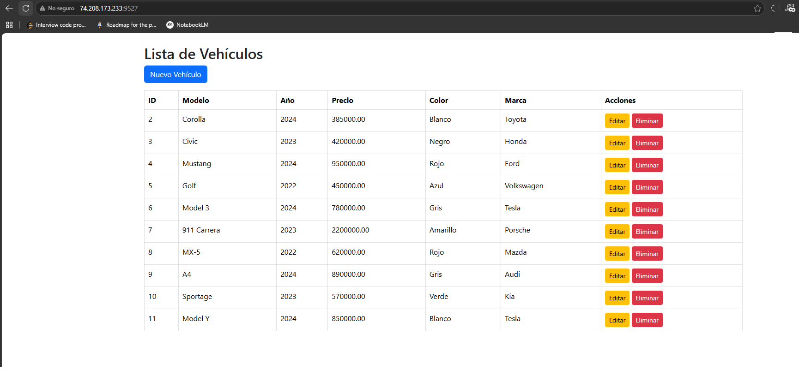
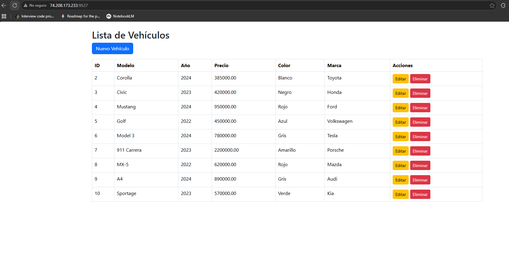
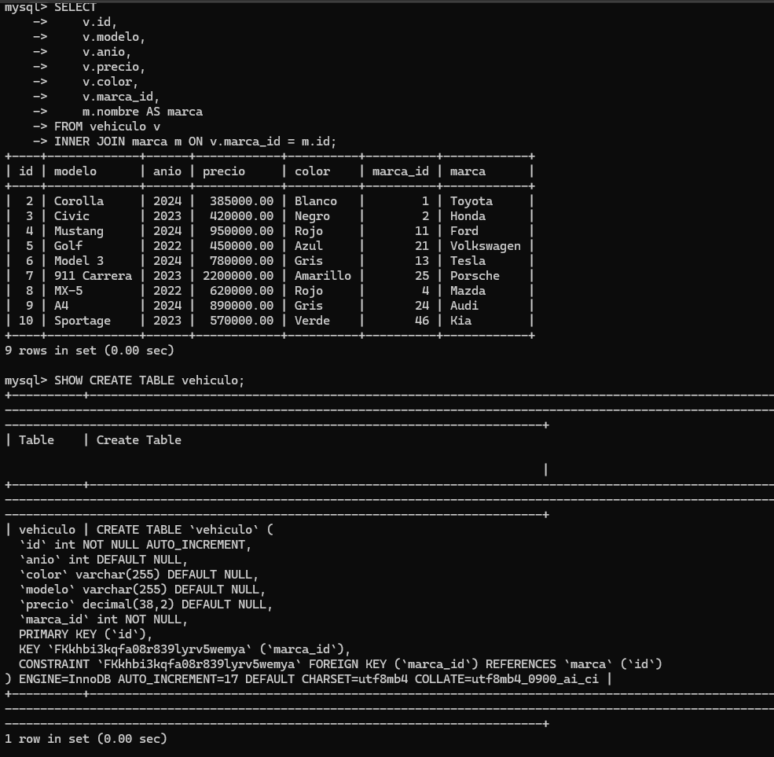

# JNV Act 3 T4 - Vehículos y marcas

Aplicación web desarrollada con Spring Boot para administrar vehículos y sus marcas. Permite realizar operaciones CRUD sobre vehículos y relacionarlos con una marca almacenada en MySQL.

## Tecnologías

- Java 25
- Spring Boot
- Spring Web MVC
- Spring Data JPA
- Thymeleaf
- MySQL
- Bootstrap 5
- Maven

## Modelo de datos

El proyecto utiliza dos entidades relacionadas:

- **Marca**
  - `id`
  - `nombre`
  - `paisOrigen`
- **Vehículo**
  - `id`
  - `modelo`
  - `anio`
  - `precio`
  - `color`
  - `marca`

La relación es de uno a muchos:

```text
Una marca puede tener muchos vehículos.
Un vehículo pertenece a una marca.
```

En JPA se implementa mediante `@OneToMany` en `Marca` y `@ManyToOne` en `vehiculo`. La llave foránea `marca_id` se encuentra en la tabla `vehiculo`.

## Requisitos

- JDK 25
- MySQL
- Maven Wrapper incluido en el proyecto

## Base de datos

Crear el schema en MySQL:

```sql
CREATE DATABASE jnvact3_t4;
```

Agregar algunas marcas para que aparezcan en el formulario:

```sql
USE jnvact3_t4;

INSERT INTO marca (nombre, pais_origen) VALUES
('Toyota', 'Japón'),
('Ford', 'Estados Unidos'),
('Volkswagen', 'Alemania');
```

La aplicación utiliza `spring.jpa.hibernate.ddl-auto=update`, por lo que Hibernate puede crear o actualizar las tablas a partir de las entidades.

## Configuración

Las credenciales no se guardan en el repositorio. La aplicación lee la contraseña desde la variable de entorno `DB_PASSWORD` y utiliza `root` como usuario predeterminado.

En PowerShell:

```powershell
$env:DB_USERNAME="root"
$env:DB_PASSWORD="TU_CONTRASEÑA"
```

También se puede definir permanentemente con `setx` y abrir una terminal nueva después:

```powershell
setx DB_USERNAME "root"
setx DB_PASSWORD "TU_CONTRASEÑA"
```

La aplicación se ejecuta en el puerto `9527`:

```text
http://localhost:9527
```

## Ejecución local

Desde la raíz del proyecto:

```powershell
.\mvnw.cmd spring-boot:run
```

Para compilar y generar el archivo `.jar`:

```powershell
.\mvnw.cmd clean package
```

## Operaciones disponibles

- `GET /` - Lista los vehículos.
- `GET /nuevo` - Muestra el formulario para crear un vehículo.
- `POST /guardar` - Crea o actualiza un vehículo.
- `GET /editar/{id}` - Muestra el formulario de edición.
- `GET /eliminar/{id}` - Elimina un vehículo.

El formulario permite seleccionar una marca y la lista muestra el nombre de la marca relacionada, no solamente su ID.

## Capturas de pantalla

### Crear un vehículo



### Listar vehículos



### Editar un vehículo



### Eliminar un vehículo





### Persistencia y relación en MySQL



## Despliegue en VPS

Para desplegar la aplicación:

1. Crear la base de datos `jnvact3_t4` en el VPS.
2. Configurar `DB_USERNAME` y `DB_PASSWORD` en el entorno del VPS.
3. Ajustar la URL JDBC para apuntar al servidor MySQL del VPS.
4. Generar y subir el `.jar`:

```powershell
.\mvnw.cmd clean package
```

5. Ejecutar el archivo en una carpeta nueva usando el puerto `9527`.
6. Verificar el CRUD desde fuera del VPS.

No se deben publicar contraseñas reales en GitHub.
